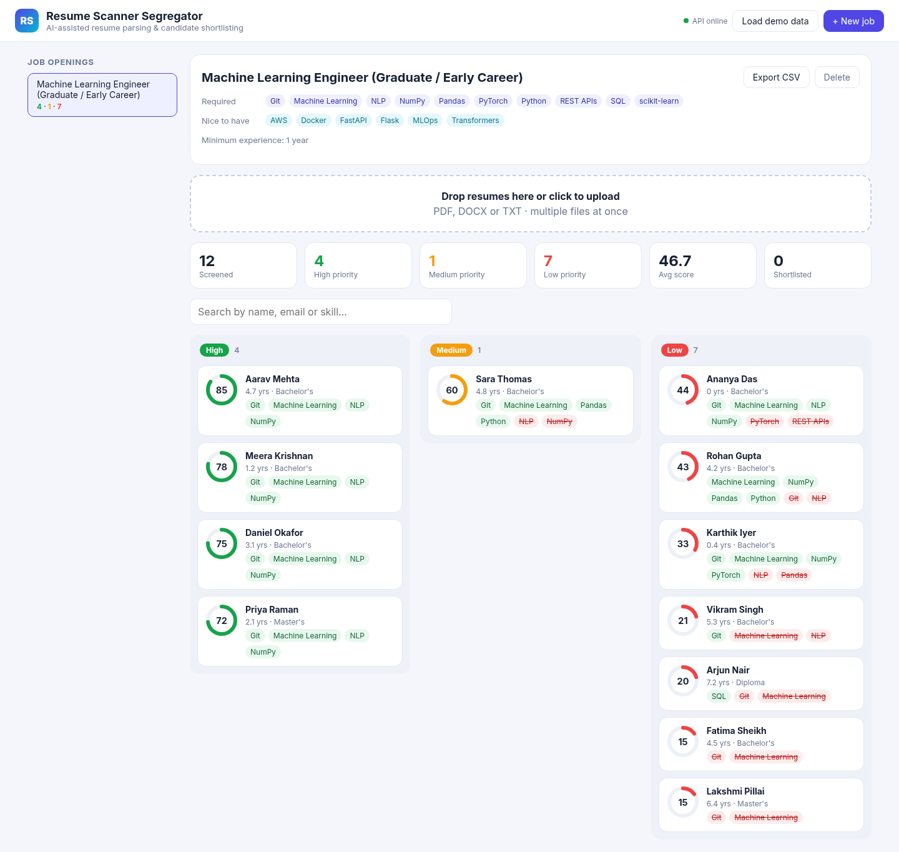
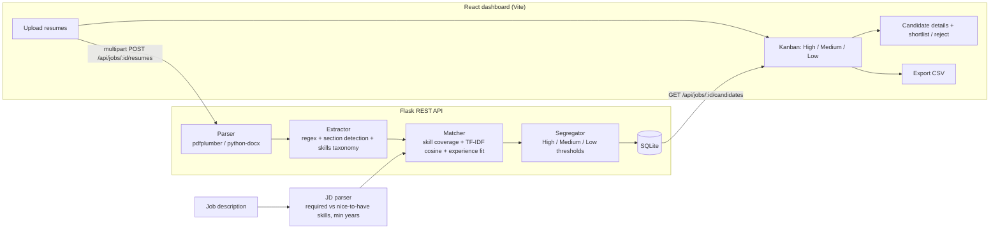
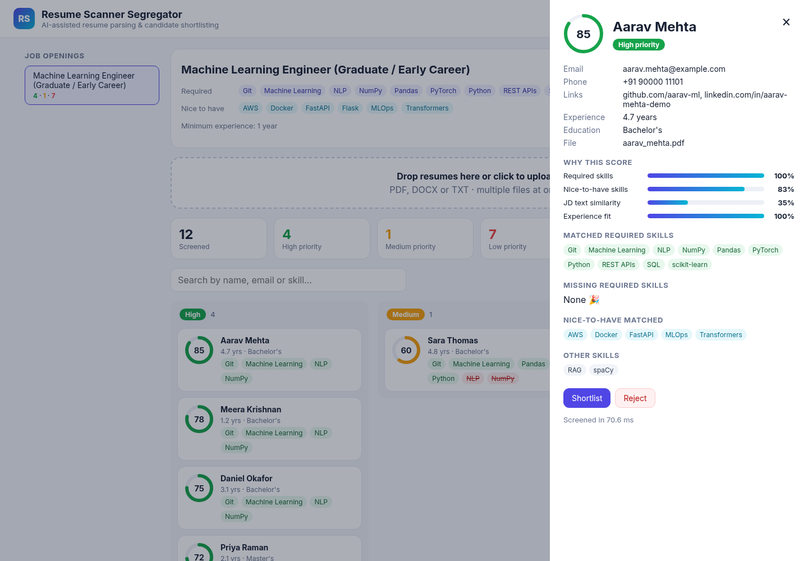
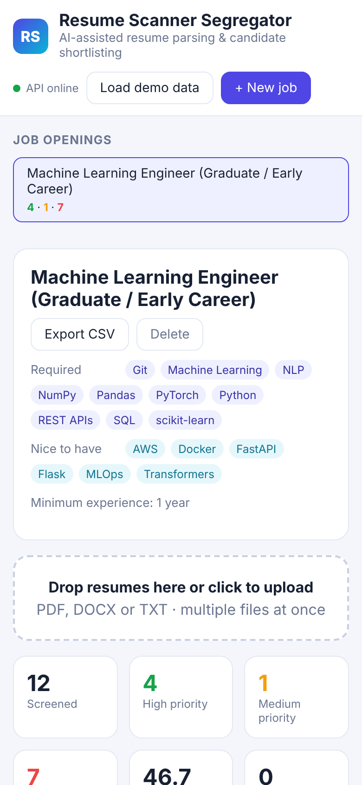

# Resume Scanner Segregator

AI-assisted recruitment tool that **parses PDF/DOCX resumes, scores every candidate against a job description, and segregates them into High, Medium and Low priority** so a recruiter can start with the best matches instead of reading every CV.

- **Backend:** Python, Flask REST API, scikit-learn (TF-IDF similarity), pdfplumber, python-docx, SQLite
- **Frontend:** React 18 + Vite recruiter dashboard (upload, kanban by priority, candidate drill-down, shortlist/reject, CSV export)
- **CLI:** screen a folder of resumes from the terminal
- Runs fully offline: no paid API keys, no GPU

### 🚀 Live demo: **https://shivesh900.github.io/resume-scanner-segregator/**

The demo opens with 12 sample resumes already screened. You can also drop in your own PDF/DOCX files: everything runs in your browser and nothing is uploaded anywhere.



## Why

Screening a pile of resumes by hand is slow and inconsistent. This project automates the first pass:

1. **Parse** each resume (PDF, DOCX or TXT) into clean text.
2. **Extract** the candidate's name, email, phone, links, education level, total experience and skills with NLP rules plus a skills taxonomy.
3. **Score** the candidate against the job description (0 to 100), with a breakdown of *why*.
4. **Segregate** candidates into **High** (score ≥ 70), **Medium** (≥ 45) and **Low** priority, which the recruiter can then shortlist or reject.

## Architecture



### Scoring

```
score = 100 × ( 0.50 × required-skill coverage
              + 0.15 × nice-to-have skill coverage
              + 0.20 × text similarity (TF-IDF cosine of JD vs resume, unigrams + bigrams)
              + 0.15 × experience fit (candidate years ÷ required years, capped at 1) )
```

- **Skills** are matched against a taxonomy of about 80 skills with aliases (`sklearn` → scikit-learn, `postgres` → PostgreSQL), using word boundaries so `Java` never matches `JavaScript`. Specialised skills imply umbrella ones (PyTorch → Deep Learning → Machine Learning).
- **Job descriptions** are split at a "Nice to have / Preferred" heading into required and optional skills, and "N+ years" sets the minimum experience.
- **Experience** comes from date ranges in the Experience section (`Jan 2022 - Present`). Overlapping roles are merged so they aren't double-counted.
- Weights (`matcher.Weights`) and thresholds (`segregator.Thresholds`) are configurable. The thresholds can also be set per run from the CLI.

## Quick start

```bash
git clone https://github.com/shivesh900/resume-scanner-segregator.git
cd resume-scanner-segregator
python -m venv .venv && source .venv/bin/activate   # Windows: .venv\Scripts\activate
pip install -r requirements-dev.txt
```

### 1. CLI

```bash
python -m resume_scanner.cli --jd sample_data/job_descriptions/ml_engineer.txt sample_data/resumes --csv shortlist.csv
```

Output on the bundled sample data:

```
Job: Machine Learning Engineer (Graduate / Early Career)
Required: Git, Machine Learning, NLP, NumPy, Pandas, PyTorch, Python, REST APIs, SQL, scikit-learn
Preferred: AWS, Docker, FastAPI, Flask, MLOps, Transformers | Min experience: 1 yrs

 #  Candidate              Score  Priority  Exp  Missing required skills
--------------------------------------------------------------------------------------
 1  Aarav Mehta             84.5  High      4.7  -
 2  Meera Krishnan          77.9  High      1.2  -
 3  Daniel Okafor           74.9  High      3.1  -
 4  Priya Raman             72.4  High      2.1  -
 5  Sara Thomas             59.5  Medium    4.8  NLP, NumPy, PyTorch
 6  Ananya Das              44.4  Low       0.0  PyTorch, REST APIs
 7  Rohan Gupta             42.6  Low       4.2  Git, NLP, PyTorch, REST APIs ...
 8  Karthik Iyer            32.7  Low       0.4  NLP, Pandas, REST APIs, SQL ...
 9  Vikram Singh            20.5  Low       5.3  Machine Learning, NLP, NumPy, Pandas ...
10  Arjun Nair              20.4  Low       7.2  Git, Machine Learning, NLP, NumPy ...
11  Fatima Sheikh           15.2  Low       4.5  Git, Machine Learning, NLP, NumPy ...
12  Lakshmi Pillai          15.2  Low       6.4  Git, Machine Learning, NLP, NumPy ...

12 resumes | High 4 | Medium 1 | Low 7 | avg 29 ms per resume
```

(Experience is measured up to today for "Present" roles, so those numbers grow over time.)

### 2. API + dashboard

```bash
# build the React dashboard once (Node 18+)
cd frontend && npm install && npm run build && cd ..

# start Flask: serves the API and the built dashboard
python -m resume_scanner.api          # http://localhost:5000
```

Open http://localhost:5000 and click **Load demo data**, or create a job and drag in your own resumes.
For frontend development, run `npm run dev` in `frontend/` (http://localhost:5173, API calls proxied to :5000).

| Candidate drill-down | Mobile |
|---|---|
|  |  |

### REST API

| Method | Endpoint | Description |
|---|---|---|
| GET | `/api/health` | Status and thresholds |
| POST | `/api/jobs` | Create a job `{title, description}`; returns the parsed required/preferred skills |
| GET | `/api/jobs` | List jobs with High/Medium/Low counts |
| POST | `/api/jobs/<id>/resumes` | Upload resumes (multipart field `files`, many at once); returns the screened candidates |
| GET | `/api/jobs/<id>/candidates?priority=High` | Ranked candidates, optionally filtered by priority |
| GET / PATCH | `/api/candidates/<id>` | Candidate detail; PATCH `{status: "shortlisted" \| "rejected" \| "new"}` |
| GET | `/api/jobs/<id>/export.csv` | Ranked shortlist as CSV |
| DELETE | `/api/jobs/<id>` | Delete a job and its candidates |
| POST | `/api/demo` | Load the sample job and screen the bundled resumes |

```bash
curl -X POST localhost:5000/api/jobs -H "Content-Type: application/json" \
     -d '{"title":"ML Engineer","description":"Requirements: Python, PyTorch, SQL, NLP. 1+ years experience."}'
curl -X POST localhost:5000/api/jobs/<job_id>/resumes -F files=@sample_data/resumes/aarav_mehta.pdf -F files=@sample_data/resumes/priya_raman.docx
```

Data is kept in memory by default. Set `RSS_DB=screening.db` to persist it in SQLite.

## How the live demo works

GitHub Pages can only host static files, so the demo runs a **JavaScript port of the same pipeline** in the browser (`frontend/src/engine/`). It uses pdf.js and mammoth for PDF/DOCX text, the same regex extractors, a scikit-learn-compatible TF-IDF (same tokeniser, stop words, sublinear tf and smoothed idf) and the same weights and thresholds. The React dashboard is identical; only the API layer is swapped (`VITE_STATIC=1`).

The two engines are kept honest by CI:
- `scripts/export_web_assets.py` generates the browser config (skills taxonomy, implications, section headings, stop words, weights, thresholds) from the Python source. CI fails if it is stale.
- `scripts/check_web_parity.py` runs both engines on the 12 sample resumes and requires **identical** scores, buckets, skills and experience. It currently passes on 12/12.

The Flask API remains the "real" backend for local and server use.

## Results (measured on the bundled data)

`sample_data/` contains **12 synthetic resumes** (8 PDF, 4 DOCX; all people, emails and companies are fictional) and two job descriptions. Each resume has a hand-assigned expected priority for the ML Engineer role in `sample_data/labels.csv`. `python scripts/evaluate.py` prints:

```
Resumes: 12
Bucket agreement with hand labels: 9/12 = 75%

Confusion matrix (rows = expected, cols = predicted)
            High  Medium     Low
    High       4       0       0
  Medium       0       1       3
     Low       0       0       4

Spearman rank correlation (score vs expected tier): 0.95
Lowest 'High' score 72.4 vs highest 'Low' score 20.5

Throughput: 29.7 resumes/sec (median 25 ms per resume, CPU only)

Misses:
  Ananya Das       expected Medium got Low    (score 44.4)
  Rohan Gupta      expected Medium got Low    (score 42.6)
  Karthik Iyer     expected Medium got Low    (score 32.7)
```

What this shows, and what it doesn't:

- The ranking is right: every High-labelled candidate scores above every Medium and Low one (Spearman ρ = 0.95).
- The default thresholds are **conservative**. The three misses are borderline candidates (a fresh graduate with no experience, a data analyst, a computer-vision intern) that were pushed down into Low rather than up. A recruiter can lower the Medium threshold (`--medium 30`) for a wider net.
- Screening takes about 25 ms per resume on a laptop CPU. That is the time saved on the first pass over a pile of resumes.
- This is a **12-resume synthetic set**, so it is a sanity check, not a benchmark. The labels were written by the author. Real-world accuracy needs real, consented resumes and recruiter decisions.

## Project structure

```
resume_scanner/
  parser.py       PDF / DOCX / TXT → clean text
  skills.py       skills taxonomy, alias matching, implied skills
  extractor.py    name, email, phone, links, sections, education, experience years
  matcher.py      JD parsing + weighted scoring with explanation
  segregator.py   High / Medium / Low thresholds
  pipeline.py     end-to-end screening of one resume
  store.py        SQLite persistence
  api.py          Flask REST API (+ serves the React build)
  cli.py          command-line interface
frontend/         React + Vite dashboard
  src/engine/     browser port of the pipeline (core.js, parse.js, localApi.js) for the live demo
scripts/          generate_sample_data.py, evaluate.py, export_web_assets.py, check_web_parity.py
sample_data/      synthetic resumes, job descriptions, labels
tests/            pytest suite (parsing, extraction, scoring, API)
```

## Tests and CI

```bash
pytest -q        # 29 tests
```

GitHub Actions runs the test suite, the evaluation and the Python↔browser parity check on Python 3.10 and 3.12, and builds the React dashboard, on every push and pull request. A second workflow deploys the live demo to GitHub Pages.

## Limitations and future work

- **Semantic matching:** swap TF-IDF for sentence embeddings (e.g. `all-MiniLM-L6-v2`) so "built neural nets" matches "deep learning" without needing an alias.
- **NER for names and companies:** use a spaCy/transformer NER model instead of heuristics for unusual resume layouts.
- **Scanned PDFs:** add OCR (Tesseract) for image-only resumes.
- **Bias and fairness:** the scorer only looks at skills, experience and text. Names, gender and photos are never used. A production version should still audit outcomes across groups.
- **Learning from recruiters:** use shortlist/reject decisions to tune the weights per role.
- Authentication and multi-recruiter workspaces.

## License

MIT. See [LICENSE](LICENSE).
